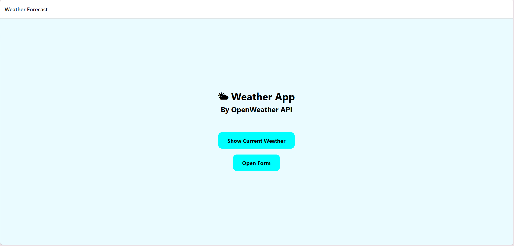
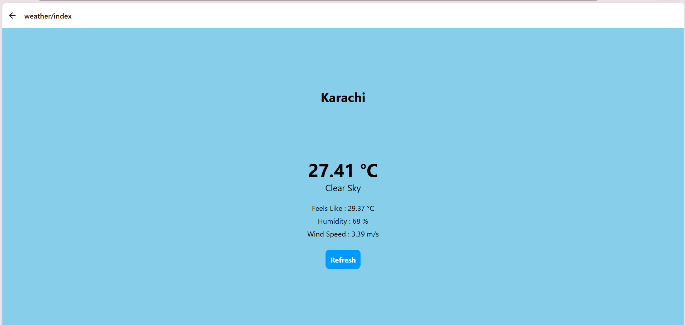
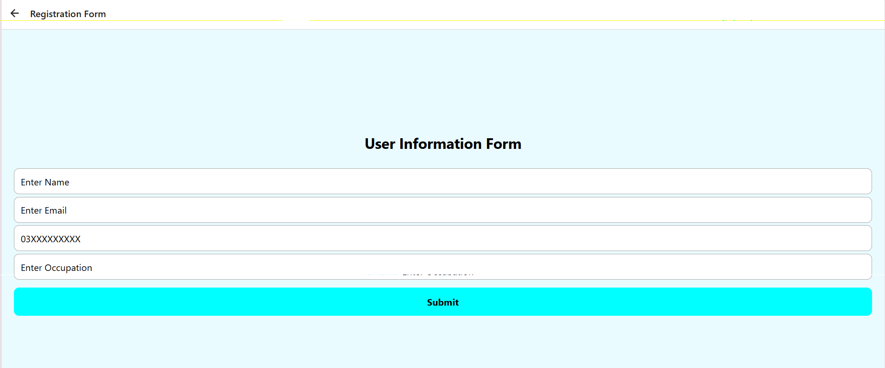

# 🌦️ Weather App

A mobile weather application built using **React Native, Expo, and JavaScript (JSX)**. The app provides a simple and intuitive interface for viewing weather information and checking conditions for different locations.

## 📱 Screenshots

<p align="center">
  
  &nbsp;&nbsp;
  
  &nbsp;&nbsp;
  
</p>

<p align="center">
  <i>Home Screen · Weather Details · User Form</i>
</p>

## ✨ Features

- 🌍 Search for weather information by location, if supported.
- 🌡️ Display current temperature and weather conditions.
- ☁️ Show weather descriptions and corresponding icons.
- 💧 Display additional details such as humidity and wind speed, if implemented.
- 📱 Mobile-friendly interface built with React Native.
- ⚡ Developed and tested using Expo.

## 🛠️ Built With

- **React Native** — Mobile application development.
- **Expo** — Development and testing environment.
- **JavaScript (JSX)** — Application logic and UI components.
- **React Hooks** — State management and component logic, if used.
- **Weather API** — Fetching weather data, if integrated.

## 📂 Project Structure

```text
Weather-App/
└──src
    └──app
        └──.env
        └──  form.jsx
        └──index.jsx
        └──_layout.jsx
        |
        └──components
        └──services
         └── postService.js
         └── weatherservice.js
        |
        └──weather
             └──index.jsx
└── README.md
```

## 🚀 Getting Started

### Prerequisites

Make sure you have the following installed:

- [Node.js](https://nodejs.org/)
- npm (included with Node.js)
- [Expo Go](https://expo.dev/go) on your mobile device, or an appropriate emulator.

### Installation

**1. Clone the repository**

```bash
git clone https://github.com/S-Eraj-Zehra/WeatherApp.git
```

**2. Navigate to the project directory**

```bash
cd WeatherApp
```

**3. Install dependencies**

```bash
npm install
```

**4. Start the Expo development server**

```bash
npx expo start
```

**5. Run the application**

- Scan the QR code using Expo Go, where your Expo SDK version is supported.
- Alternatively, press the appropriate key in the terminal to launch an available emulator.

## 🌤️ Weather API Configuration

If the application uses an external weather API:

1. Obtain an API key from your weather data provider.
2. Configure the API key according to your project's environment setup.
3. Ensure that API requests use the correct endpoint and parameters.

## 🔮 Future Improvements

- [ ] Add hourly and weekly forecasts.
- [ ] Implement location-based weather detection.
- [ ] Add Celsius and Fahrenheit conversion.
- [ ] Improve loading indicators and error handling.
- [ ] Introduce light and dark themes.
- [ ] Enhance the user interface and animations.

## 👩‍💻 Author

**Syeda Eraj Zehra**

- GitHub: https://github.com/S-Eraj-Zehra/
- LinkedIn: https://www.linkedin.com/in/e-zehra/

## 📄 License

This project is intended for learning and personal development. If you plan to distribute it publicly, consider adding an appropriate open-source license.

---

<p align="center">
  Made using React Native and Expo
</p>
